<h3><code>anil@github ~ $ ./contributions.sh</code></h3>

  

<h3><code>anil@github ~ $ whoami</code></h3>

<table>
<tr>
<td valign="top" width="45%">

</td>

<td valign="top" width="55%">

</td>
</tr>
</table>

---

## 👨‍💻 About Me

AI & Data Science student passionate about software engineering, machine learning, efficient algorithms, and building practical end-to-end applications.

- 🎓 **Education:** B.Tech in Artificial Intelligence & Data Science at KL University
- 💡 **Interests:** Machine Learning, Computer Vision, Data Structures, Web Development, and Automation
- 🌱 **Currently Exploring:** Advanced ML models, System Architecture, and Embedded Systems

---

## 🎯 Current Focus

- 🐍 **Python Ecosystem:** Data Analysis, Computer Vision, and Automation Pipelines
- 🤖 **Machine Learning:** Predictive Modeling, Pattern Recognition, and Neural Networks
- ⚡ **Computer Science Core:** Data Structures & Algorithms, Operating Systems, and Network Fundamentals
- 🌐 **Web Development:** Modern JavaScript, Responsive UI/UX, and RESTful APIs

---

## 🛠️ Tech Stack

- **Languages:** Python, Java, C, JavaScript, HTML5/CSS3
- **Frameworks & Tools:** OpenCV, NumPy, Pandas, React, Node.js, Git, GitHub, Linux (WSL), VS Code

---

## 🚀 Featured Projects

- **DevGram:** A developer-focused social platform connecting developers, showcasing portfolios, and sharing code snippets.
- **AI / ML Computer Vision Projects:** Image classification, object tracking, and local image preprocessing pipelines.
- **Interactive Web Applications:** Responsive web dashboards and automated profile asset generators.

---

  Powered by Python 3.12 &amp; Pure SVG Animations &bull; Built by <a href="https://github.com/AnilkumarMaripi">Anil Kumar</a>

